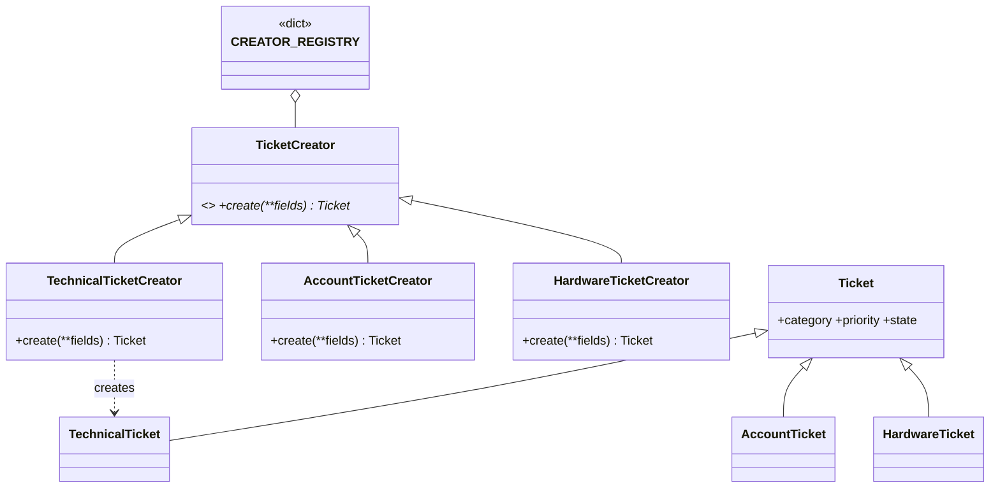
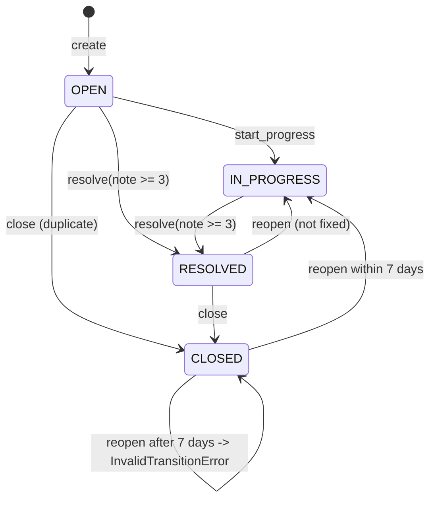
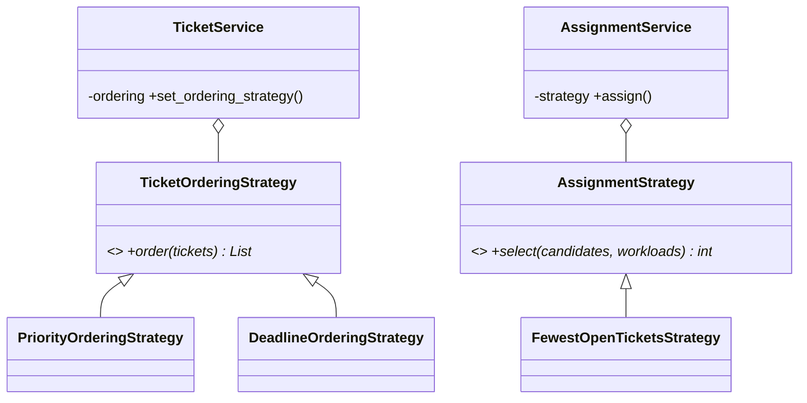
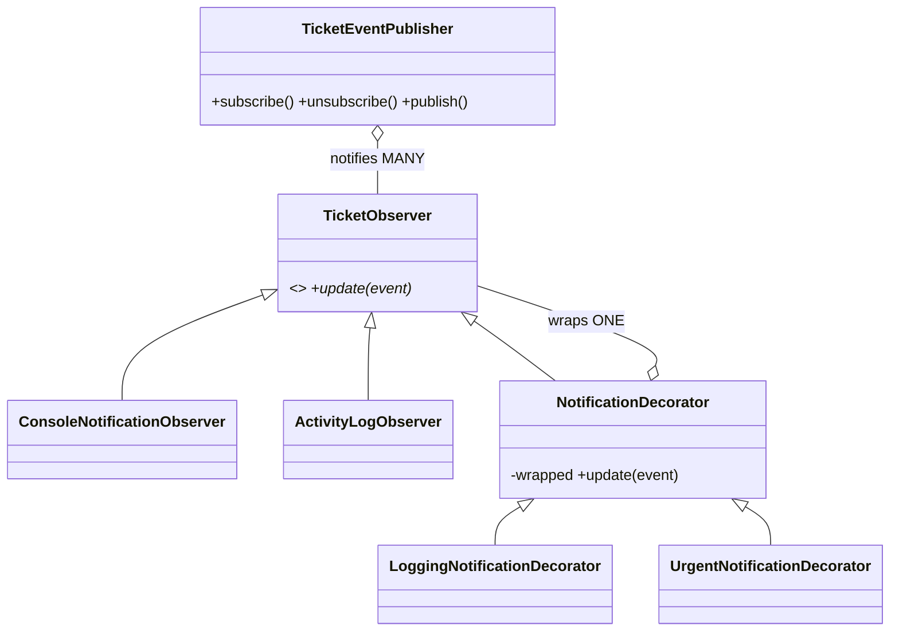

# HelpDesk - Ticket Management System

A console application for creating, listing, ordering, assigning and resolving
support tickets, built as a design-patterns course project. It implements all
five GoF patterns used in the brief: **Factory Method, State, Strategy,
Observer and Decorator**.

---

## 1. Quick start (Windows / PowerShell)

```powershell
cd E:\PROGRAMMING\vs-code\HelpDesk-shared
.\.venv\Scripts\Activate.ps1
python -m pip install -r requirements.txt
python -m pip install -e .
python -m pytest -q
python -m helpdesk.database.seed
helpdesk                     # or: python -m helpdesk.main
```

The seed is idempotent: running it twice refuses to duplicate data. It creates
6 staff and 11 tickets (`helpdesk.db`, ignored by Git).

Console menu:

| Option | Action |
| --- | --- |
| `1` | Create a ticket (prompts category-specific mandatory fields) |
| `2` | List tickets (current ordering strategy) |
| `3` | View a ticket (`HD-0001` or the numeric id) |
| `4` | Switch ordering strategy (Priority BR-4 / Deadline BR-5) |
| `5` | Assign a ticket (explicit staff id or AUTO = fewest open, BR-8) |
| `6` | Show staff workloads (OPEN + IN_PROGRESS counts) |
| `7` | Transition a ticket (start / resolve / close / reopen) |
| `0` | Exit |

---

## 2. Manual test plan (fresh seeded DB — new tickets start at HD-0012)

### Navigation edges
```
Choose: clear              -> Unknown option.
Choose: 3 -> 12            -> Use the HD-<id> form.
Choose: 3 -> HD-9999       -> Rejected: Ticket #9999 does not exist.
Choose: 5 -> HD-9999       -> Rejected: Ticket #9999 does not exist.
Choose: 7 -> nope          -> Use the HD-<id> form.
Choose: 0                  -> Bye.
```

### Create all three categories
```
[1] Title: HP-0987
    Description: Printer stopped responding after update
    Category: 1 (TECHNICAL)   Priority: 2 (MEDIUM)
    Deadline: 2030-12-06 12:00   Component: printer
    -> [LOG] ... [console] [#12] Ticket 'HP-0987' created [TECHNICAL/MEDIUM]
    -> Created ticket HD-0012 [OPEN]

[1] Category: 2 (ACCOUNT)  Priority: 4 (CRITICAL)  Affected account: registrar.office
    -> [URGENT] notification appears (HIGH/CRITICAL only)

[1] Category: 3 (HARDWARE) Priority: 1 (LOW)
    Asset tag: pc-1234 (stored as PC-1234)   Location: Lab 4
```

Validation checks (each leaves the ticket count unchanged):
```
empty title        -> Rejected: Title must be 3-120 characters.
short description  -> Rejected: Description must be at least 10 characters.
bad component      -> Rejected: Component 'x' is unknown. Allowed: network, email, ...
missing component  -> Rejected: 'component' is required for TECHNICAL tickets ...
bad category key   -> Option not recognized.   (prompt repeats)
bad deadline       -> That is not a date. Retry (YYYY-MM-DD HH:MM) or empty:
```

### List / View / Ordering
```
[2] default order = priority: CRITICAL first, oldest first inside a priority.
[4] -> 2  -> "OK - deadline ordering active."
[2] now: tickets with deadlines first (earliest first, nulls last).
[4] -> 9  -> "Unknown option - ordering strategy unchanged."
[3] HD-0012 -> ID / Title / Description / Category / Priority / Status /
               Deadline / Assigned staff / Closed / Resolution note
```

### Assignment (BR-7 / BR-8)
```
[5] HD-0012 -> AUTO (or Enter) -> Assigned HD-0012 -> staff #5.
[5] HD-0013 -> 2               -> Assigned HD-0013 -> staff #2.
[5] HD-0014 -> abc             -> Not a staff id: 'abc' - nothing changed.
[5] HD-0009 (RESOLVED)         -> BR-7: only OPEN or IN_PROGRESS tickets ...
[6] shows workloads: 1=2, 2=3, 3=1, 4=1, 5=1, 6=0 (after the assignments above).
```

### Lifecycle (BR-1 / BR-2 / BR-3)
```
[7] HD-0004 -> 3 (close)  -> Rejected: Cannot close: the ticket must be resolved first.
[7] HD-0012 -> 1          -> Ticket HD-0012 is now IN_PROGRESS.
[7] HD-0012 -> 2 -> ""    -> Rejected: A resolution note (min 3 chars) is required ...
[7] HD-0012 -> 2 -> "Replaced the print driver" -> RESOLVED.
[7] HD-0012 -> 3          -> CLOSED (Closed + Resolution note visible in [3]).
[7] HD-0010 -> 4          -> IN_PROGRESS  (closed 2 days ago: within window).
[7] HD-0011 -> 4          -> Rejected: ... more than 7 days ago (window expired).
[7] HD-0001 -> 4          -> Rejected: Cannot reopen: the ticket is already open.
[7] HD-0013 -> 9          -> Unknown action - nothing changed.
```

### Verify the invisible side effects
```powershell
.\.venv\Scripts\python.exe -c "from helpdesk.database.database import Database; from helpdesk.repositories.activity_repository import ActivityRepository; print([(a.ticket_id,a.action) for a in ActivityRepository(Database('helpdesk.db')).list_for(12)])"
```
Expected: `[(12, 'TicketCreated'), (12, 'TicketStatusChanged'), ...]`

Reset any time with `Remove-Item helpdesk.db`, then re-run the seed.

---

## 3. Pattern map (roles)

| Pattern | Role | Code |
| --- | --- | --- |
| **Factory Method** | Creator (abstract) | `patterns/factory/abstract_creator.py::TicketCreator` |
| | Concrete Creators | `technical_creator.py`, `account_creator.py`, `hardware_creator.py` |
| | Product / Concrete Products | `models/ticket.py::Ticket` + `TechnicalTicket`, `AccountTicket`, `HardwareTicket` |
| | Registry | `patterns/factory/__init__.py::CREATOR_REGISTRY` |
| **State** | Context | `models/ticket.py::Ticket` |
| | Abstract / Concrete States | `patterns/state/base_state.py::TicketState`; `states.py::OpenState, InProgressState, ResolvedState, ClosedState` |
| | Singletons | `OPEN_STATE`, `IN_PROGRESS_STATE`, `RESOLVED_STATE`, `CLOSED_STATE` |
| **Strategy** | Abstract + Concrete (ordering) | `patterns/strategy/ordering_strategies.py` (PRIORITY, DEADLINE) |
| | Abstract + Concrete (assignment) | `patterns/strategy/assignment_strategies.py` (`FewestOpenTicketsStrategy`) |
| | Contexts | `services/ticket_service.py`, `services/assignment_service.py` |
| **Observer** | Subject | `patterns/observer/publisher.py::TicketEventPublisher` |
| | Interface + Concrete Observers | `patterns/observer/observers.py` (`ConsoleNotificationObserver`, `ActivityLogObserver`) |
| | Events | `patterns/observer/events.py` |
| **Decorator** | Component / ConcreteComponent | `TicketObserver` / `ConsoleNotificationObserver` |
| | Base + Concrete Decorators | `patterns/decorator/notification_decorators.py` (`LoggingNotificationDecorator`, `UrgentNotificationDecorator`) |
| | Composition root | `main.py::build_application` builds `Logging(Urgent(Console))` |

**Explicit non-patterns:** `state_for()` is an infrastructure dict lookup (no
creator hierarchy); `ConsoleNotificationService` is a channel interface;
repositories are Data Mapper-style persistence, not a GoF pattern.

Dependency direction: `cli -> services -> patterns -> models -> database`;
domain never imports services, repositories or CLI. States import `Ticket`
only under `TYPE_CHECKING`, which breaks the import cycle.

---

## 4. UML-style diagrams (Mermaid)

### Factory Method



### State



All other cells are explicit rejections with reasons; `tests/test_state_matrix.py`
pins the full 4x4 matrix. BR-2 boundary is inclusive at 7 days (1 ms scheduling
tolerance; 1 second over is refused). Reopen clears `closed_at` and the old note.

### Strategy



### Observer + Decorator



Events are immutable; `UrgentNotificationDecorator` uses `dataclasses.replace`,
so a shared event is never mutated. The publisher isolates observer failures.

### Wiring (composition root)

```mermaid
flowchart TB
    CLI[ConsoleMenu] --> TS[TicketService]
    CLI --> AS[AssignmentService]
    TS --> TR[TicketRepository]
    AS --> TR
    AS --> SR[StaffRepository]
    TS --> PUB[TicketEventPublisher]
    AS --> PUB
    PUB --> DEC[Logging(Urgent(Console))]
    PUB --> ALO[ActivityLogObserver]
    DEC --> CON[ConsoleNotificationObserver]
    ALO --> AR[ActivityRepository]
    TR --> DB[(SQLite)]
    SR --> DB
    AR --> DB
```

---

## 5. Database design

SQLite (`helpdesk.db`). `Database.initialize()` executes the schema in
`src/helpdesk/database/database.py` (safe to call repeatedly).

| Table | Columns / notes |
| --- | --- |
| `staff` | `id`, `full_name`, `role`, `created_at` (ISO-8601; seed uses FAKE_NOW - N days; also BR-8 tie-break) |
| `tickets` | `id`, `title`, `description`, `category`, `priority`, `status`, `created_at`, `updated_at`, `deadline`, `assigned_staff_id`, `technical_component`, `affected_account`, `asset_tag`, `location`, `closed_at`, `resolution_note` |
| `ticket_activity` | `id`, `ticket_id` (FK ON DELETE CASCADE), `action`, `description`, `created_at` |
| `notifications` | `id`, `ticket_id` (FK ON DELETE SET NULL), `recipient`, `channel`, `message`, `sent_at` |

CHECK constraints: category in `TECHNICAL/ACCOUNT/HARDWARE`, priority in
`LOW/MEDIUM/HIGH/CRITICAL`, status in `OPEN/IN_PROGRESS/RESOLVED/CLOSED`.
One wide table is intentional: all three products share one persistence
round-trip; only Python behaviour differs.

Integrity: `PRAGMA foreign_keys = ON` per connection; writes use
`Database.transaction()` (commit/rollback), reads use `Database.connection()`.
Datetimes cross the boundary as ISO-8601 text; `_as_utc()` prevents naive/aware
comparison errors. Indexes: `status`, `priority`, `category`, `assigned_staff_id`,
`deadline`, `ticket_activity.ticket_id`.

Seed invariants: 6 staff, 11 tickets; workloads 1=2, 2=2, 3=1, 4=1, 5=0, 6=0,
so two AUTO assignments pick staff 5 then 6. `Outage came back` (closed 2 days
ago) demonstrates an allowed reopen; `Dead dock station` (10 days ago) a refused
one. Those two timestamps use the wall clock; everything else uses
`FAKE_NOW = 2026-11-02 09:00Z`.

---

## 6. Business rules and traceability

| Rule | Implementation | Evidence (pytest file) |
| --- | --- | --- |
| BR-1 lifecycle matrix | `patterns/state/states.py` | `test_state.py`, `test_state_matrix.py` |
| BR-2 7-day reopen window | `ClosedState.reopen` | `test_reopen_window.py` |
| BR-3 resolution note >= 3 | `validate_resolution_note` | `test_validator_edges.py`, `test_state.py` |
| BR-4 priority ordering | `PriorityOrderingStrategy` | `test_strategy.py` |
| BR-5 deadline ordering, nulls last | `DeadlineOrderingStrategy` | `test_strategy.py` |
| BR-6 category mandatory fields | Factory creators | `test_factory.py` |
| BR-7 assignment eligibility | `AssignmentService.assign` | `test_integration.py`, `test_integration_suite.py` |
| BR-8 least-loaded assignment | `FewestOpenTicketsStrategy` + workload counts | `test_strategy.py`, `test_seed.py` |
| BR-9 canonical tokens | `ticket_types.py`, validators, DB CHECKs | `test_validators.py`, `test_validator_edges.py` |
| FR-10 runtime strategy switch | `set_ordering_strategy`, CLI option 4 | `test_strategy.py`, `test_integration.py` |
| Observer / Decorator | publisher, observers, decorator stack | `test_observer.py`, `test_decorator.py`, `test_integration*.py` |
| CLI parsing | `cli/menu.py` | `test_cli_parsing.py` |
| Idempotent seed | `database/seed.py` | `test_seed.py` |

---

## 7. Testing

```powershell
pytest        # 207 passed, 7 skipped
```

The 7 skips are intentional: allowed cells in the BR-1 matrix test, where a
rejection cannot occur. Tests use one isolated temp database per test
(`tests/conftest.py`, NFR-4). CI: `.github/workflows/ci.yml` runs on
`windows-latest` with Python 3.13.

Integration coverage crosses at least two boundaries (CLI/service, service/
repository, publisher/observer/decorator/DB). The G-series demos are mapped in
section 2 above: G1 create, G2 ordering, G3 AUTO assignment, G4 illegal
transition, G5 reopen windows, G6 notifications/decorator output.

---

## 8. Compliance checklist

- [x] Five patterns implemented with the roles listed in section 3.
- [x] BR-1..BR-9, FR-10 implemented and tested.
- [x] Single git branch `main`; CI updated to Windows / Python 3.13.
- [x] No printing in domain/services (only CLI and decorators).
- [x] No raw SQL outside `Database` and repositories.
- [x] Idempotent, deterministic seed; wall-clock only for BR-2 demo tickets.
- [x] `python -m pytest -q`: 207 passed, 7 intentional skips.
- [x] CLI and composition-root smoke tests pass.

Documented deviations: `Ticket.status` is an alias of `status_code`
(`status_display` is the readable name); `models/states.py` and
`patterns/observer/observer.py` are thin re-export shims for old imports;
BR-2 seed timestamps are wall-clock relative so the demo works on any date.

---

## 9. Individual contributions (M1 / M2 / M3)

### M1 - Foundation
- Schema, `Database` connection/transaction lifecycle, repositories (staff,
  ticket, activity, notifications), ISO-8601 datetime handling.
- Observer core: `TicketEventPublisher`, immutable events, failure isolation.
- `TicketService` create/list/get with service-owned clock; `tmp_path` DB fixture.

### M2 - Patterns
- State: Context `Ticket`, abstract state, four concrete states, central BR-1
  matrix, BR-2 window, reasons for every rejection.
- Factory Method: abstract creator, three creators, registry, three products
  with category behaviour; mandatory fields enforced at creation.
- Strategy: ordering (priority/deadline) and assignment (fewest-open) policies;
  `AssignmentService` enforces BR-7 and publishes `StaffAssignedEvent`.

### M3 - Wiring and delivery
- Decorator stack built only in the composition root; no observer was edited.
- CLI extended to options 1-7 with `HD-<id>` parsing and defensive input.
- Deterministic/idempotent seed, repository hardening, indexes.
- CI, this documentation, and the full unit/matrix/edge/integration test suite.
