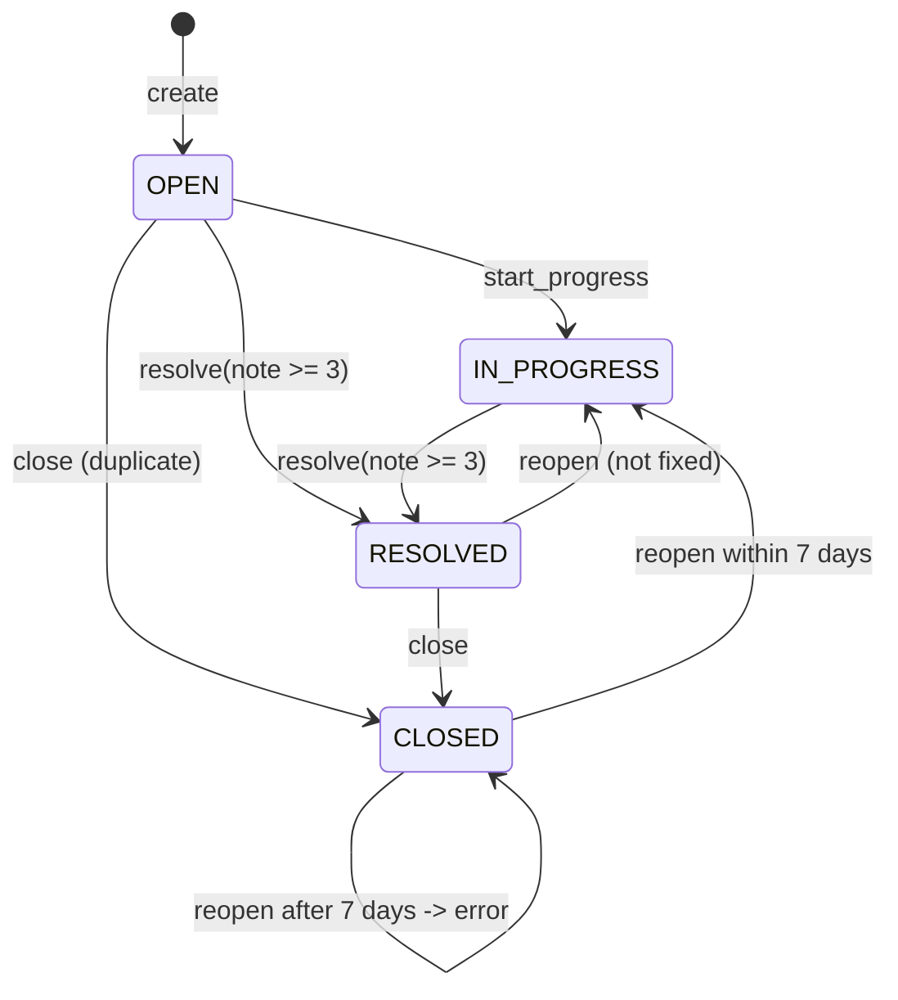
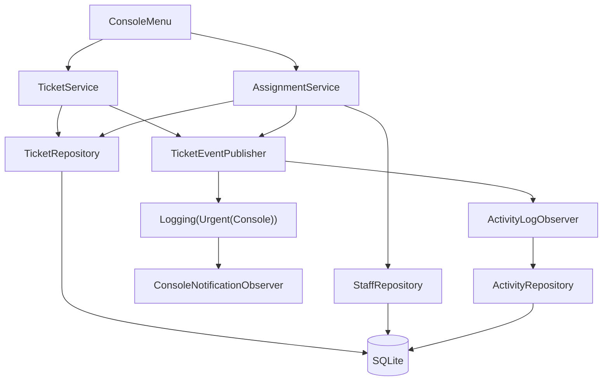

# HelpDesk - ticket management system

This is the console app we built for the design patterns course. It started out
as a small "create a ticket, print it" program and grew into something with all
five patterns from the brief actually wired together: Factory Method, State,
Strategy, Observer and Decorator.

The idea is simple: a support agent creates a ticket, picks one of three
categories, gives it a priority, assigns it to someone, and then moves it
through its lifecycle. The interesting part (for the course at least) is *how*
those decisions are made in the code — none of the rules are scattered around
in `if` statements.

## Running it

From the project folder:

```powershell
.\.venv\Scripts\Activate.ps1
python -m pip install -r requirements.txt
python -m pip install -e .
python -m pytest -q
python -m helpdesk.database.seed
helpdesk
```

If `helpdesk` isn't on your PATH, `python -m helpdesk.main` does the same thing.

The seed only needs running once. If you run it again it just says it refuses
to duplicate data. To start over, delete `helpdesk.db` and seed again — the
database file is ignored by Git, so it never ends up in a commit.

## The menu

```
[1] Create  [2] List  [3] View  [4] Ordering  [5] Assign  [6] Workloads  [7] Transition  [0] Exit
```

- **1** asks for a title and description, then category and priority as numbers.
  Depending on the category it asks for one extra field: a component for
  TECHNICAL, an account name for ACCOUNT, or an asset tag + location for
  HARDWARE. Leave the deadline empty if there isn't one.
- **2** lists tickets using whichever ordering strategy is currently selected.
- **3** shows one ticket — type `HD-0012` or just `12`.
- **4** switches between priority order and deadline order while the app is
  running. Nothing needs restarting.
- **5** assigns a ticket. Type a staff id, or just press Enter (typing `AUTO`
  works too) and the app picks the person with the fewest open tickets.
- **6** prints the workload of every staff member.
- **7** moves a ticket: start progress, resolve, close or reopen.
- **0** exits.

Bad input doesn't crash anything. You get a short `Rejected: ...` or a hint and
the menu comes back.

## A quick manual walkthrough

This assumes a fresh seeded database, so the tickets you create start at
`HD-0012`.

Create one of each category:

```
Choose: 1
Title: HP-0987
Description (min 10 chars): Printer stopped responding after update
Category [1] TECHNICAL, [2] ACCOUNT, [3] HARDWARE: 1
Priority [1] LOW, [2] MEDIUM, [3] HIGH, [4] CRITICAL: 2
Deadline (YYYY-MM-DD HH:MM, empty = none): 2030-12-06 12:00
Component (network/email/...): printer
[LOG] ... TicketCreated: Ticket 'HP-0987' created [TECHNICAL/MEDIUM]
[console] [#12] Ticket 'HP-0987' created [TECHNICAL/MEDIUM]
Created ticket HD-0012 [OPEN]
```

For ACCOUNT it asks for `Affected account`, for HARDWARE it asks for
`Asset tag (PC-1234)` and `Location`. Try leaving one of those empty — you'll
get a `Rejected: 'component' is required ...` style message. An unknown
component, a 2-character title, or a deadline like "yesterday" are all caught
too.

Then try the rest:

```
[2]             -> list, CRITICAL tickets first by default
[4] -> 2 -> [2] -> now sorted by earliest deadline, tickets without one last
[3] -> HD-0012  -> full details, including Deadline / Assigned staff / Closed

[5] -> HD-0012 -> AUTO     -> Assigned HD-0012 -> staff #5.
[5] -> HD-0013 -> 2        -> Assigned HD-0013 -> staff #2.
[5] -> HD-0014 -> abc      -> Not a staff id: 'abc' - nothing changed.
[5] -> HD-0009            -> BR-7: only OPEN or IN_PROGRESS tickets can be assigned.
[6]             -> workloads, two free staff get picked first by AUTO
```

Lifecycle is where the rules show up:

```
[7] -> HD-0004 -> 3        -> Rejected: Cannot close: the ticket must be resolved first.
[7] -> HD-0012 -> 1        -> IN_PROGRESS
[7] -> HD-0012 -> 2 -> ""  -> Rejected: A resolution note (min 3 chars) is required ...
[7] -> HD-0012 -> 2 -> "Replaced the print driver" -> RESOLVED
[7] -> HD-0012 -> 3        -> CLOSED
[7] -> HD-0010 -> 4        -> IN_PROGRESS  (closed 2 days ago, still inside the window)
[7] -> HD-0011 -> 4        -> Rejected: ... more than 7 days ago (window expired)
```

There's a `[LOG]` line for every event, and `[URGENT]` appears only for HIGH and
CRITICAL tickets. If you want to check that activity was actually stored, not
just printed:

```powershell
.\.venv\Scripts\python.exe -c "from helpdesk.database.database import Database; from helpdesk.repositories.activity_repository import ActivityRepository; print([(a.ticket_id,a.action) for a in ActivityRepository(Database('helpdesk.db')).list_for(12)])"
```

## How the code is laid out

```
src/helpdesk/
  cli/          menu and console printing
  services/     TicketService, AssignmentService (the use cases)
  patterns/     state, factory, strategy, observer, decorator
  models/       Ticket, Staff, validators, exceptions, token enums
  repositories/ all the SQL, through Database
  database/     schema, connection helpers, seed
tests/          pytest suite
```

Domain code never imports the CLI or a service, and the only SQL lives in the
database/repositories layer.

Where each pattern ended up:

| Pattern | Where it lives |
| --- | --- |
| Factory Method | `patterns/factory/` — `TicketCreator`, three concrete creators and `CREATOR_REGISTRY`. `Ticket` is the product base; `TechnicalTicket`, `AccountTicket` and `HardwareTicket` are the products. |
| State | `patterns/state/` — `TicketState` plus Open / InProgress / Resolved / Closed. `Ticket` is the context and just delegates its lifecycle calls. |
| Strategy | `patterns/strategy/` — two ordering strategies and the fewest-open assignment strategy. `TicketService` and `AssignmentService` hold one each and can swap them at runtime. |
| Observer | `patterns/observer/` — `TicketEventPublisher` notifies the console and activity-log observers about created/assigned/status-changed events. |
| Decorator | `patterns/decorator/notification_decorators.py` — wraps the same `TicketObserver` interface. `main.py` builds `Logging(Urgent(Console))`. |

Two things that look like patterns but aren't: `state_for()` in the state module
is just a dict lookup to rebuild a state when reading from SQLite (no creator
hierarchy, so not a Factory Method), and `ConsoleNotificationService` is only
the channel the observer prints through.

The lifecycle matrix is in one place only — `patterns/state/states.py`. Every
rejected transition raises `InvalidTransitionError` with a reason; there are no
silent no-ops.



The full 4x4 version of that table is pinned by `tests/test_state_matrix.py`.
The 7-day reopen boundary counts as inclusive; a millisecond of clock jitter is
fine, one second past it is refused.

This is how the pieces are connected at startup:



`main.py::build_application()` is the only place that knows the concrete
classes. That's also the only place the decorator stack is assembled, so the
observers themselves never had to change.

## Database

The schema is in `database/database.py` and `initialize()` can be called as many
times as you like. Four tables:

- `staff` — id, name, role, created_at.
- `tickets` — the one wide table with all ticket fields: title, description,
  category, priority, status, timestamps, deadline, assigned staff, the three
  category-specific fields, `closed_at` and `resolution_note`.
- `ticket_activity` — what the activity observer writes.
- `notifications` — kept for the notification repository contract.

Category, priority and status have CHECK constraints so bad values can't reach
the database even if a validator is missed. Dates are stored as ISO-8601 text
and parsed back in the repositories. Foreign keys are turned on for every
connection (SQLite doesn't do that by default), writes go through a transaction
that rolls back on failure, and there are indexes on the columns the
repositories actually filter by.

Keeping one wide table was deliberate: all three ticket products use the same
save/load code, only their Python behaviour differs.

The seed puts in 6 staff and 11 tickets. Workloads come out as 2, 2, 1, 1, 0, 0
so two AUTO assignments reliably pick staff 5 then 6. Two closed tickets are
there for the reopen demo: `Outage came back` (2 days ago, allowed) and `Dead
dock station` (10 days ago, refused). Their `closed_at` values are relative to
the current date so the demo keeps working later; the rest of the seed is
frozen at `FAKE_NOW = 2026-11-02 09:00Z`.

## Rules we had to follow

| Rule | How it's handled |
| --- | --- |
| BR-1 | Legal state transitions; matrix lives in `states.py` |
| BR-2 | Reopen only within 7 days of closing |
| BR-3 | Resolution note must be at least 3 characters, and is cleared on reopen |
| BR-4 | Priority order: CRITICAL > HIGH > MEDIUM > LOW, oldest first |
| BR-5 | Deadline order: earliest first, no-deadline tickets last |
| BR-6 | TECHNICAL needs a component, ACCOUNT an account, HARDWARE a tag and location |
| BR-7 | Only OPEN or IN_PROGRESS tickets can be assigned |
| BR-8 | AUTO assignment picks the fewest OPEN+IN_PROGRESS tickets |
| BR-9 | Uppercase category/priority/status tokens everywhere, enforced by validators and CHECKs |
| FR-10 | Ordering strategy can be changed while the app is running |

`tests/test_state.py`, `test_state_matrix.py`, `test_reopen_window.py`,
`test_factory.py`, `test_strategy.py`, `test_validator_edges.py`,
`test_repository_edges.py`, `test_seed.py`, `test_integration.py`,
`test_integration_suite.py`, `test_cli_parsing.py` and the older service/observer
tests cover these. Every test gets its own temporary database, so they don't
interfere with each other or with your real `helpdesk.db`.

## Tests and CI

```powershell
pytest
```

Last run here: **207 passed, 7 skipped**. The skips are on purpose — they're the
cells of the state matrix where the transition is allowed, so there's no
rejection message to check.

GitHub Actions runs the same suite on `windows-latest` with Python 3.13
(`.github/workflows/ci.yml`). We need 3.11+ anyway because of `StrEnum`.

## A few decisions worth mentioning

- `Ticket.status` still returns the stored uppercase code because some older
  callers expect that. `status_display` returns "Open", "In Progress" etc. if
  you want the readable version.
- `models/states.py` and `patterns/observer/observer.py` just re-export things
  from their "proper" packages. They're there so older imports don't break.
- The two BR-2 seed timestamps are wall-clock relative, as mentioned above.
  Everything else in the seed is fixed.

## What each milestone added

**M1 - the foundation.** Schema, `Database` with its transaction/read contexts,
the repositories, the event publisher and the first version of `TicketService`.
Also the temporary-database test fixture.

**M2 - the patterns.** State (with the whole lifecycle matrix), Factory Method
(the three creators and products), Strategy (ordering and assignment),
`AssignmentService` and the BR-7 guard.

**M3 - wiring and finishing.** The decorator stack, the CLI expanded to options
1-7, the seed, hardening (indexes, datetime edge cases, `updated_at` default),
CI and the integration tests.
