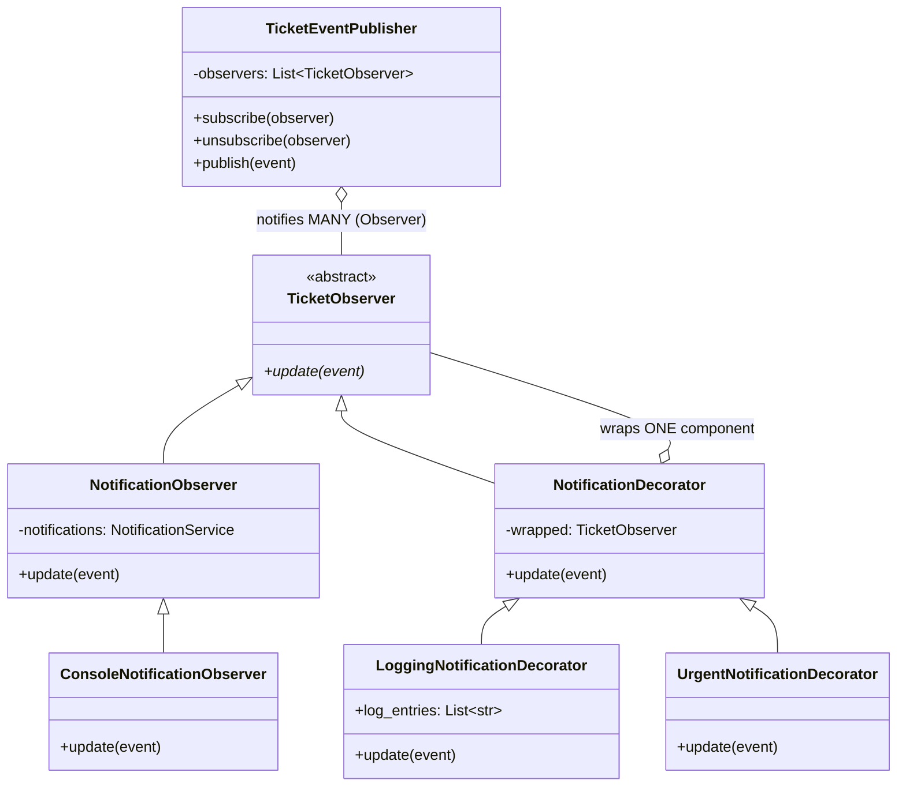

# Decorator pattern - notification stack

Composition root (`main.py`) builds `Logging(Urgent(Console))`.

| Role | Class |
|---|---|
| Component | `TicketObserver` (reused from Observer, W1) |
| ConcreteComponent | `ConsoleNotificationObserver` |
| BaseDecorator | `NotificationDecorator` |
| ConcreteDecorators | `LoggingNotificationDecorator`, `UrgentNotificationDecorator` |

Code: `src/helpdesk/patterns/decorator/notification_decorators.py` · Evidence: `tests/test_decorator.py` (8 tests)
