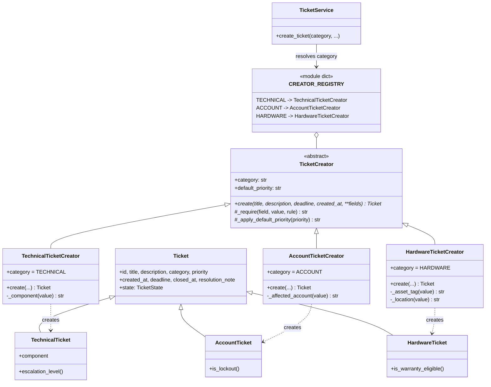
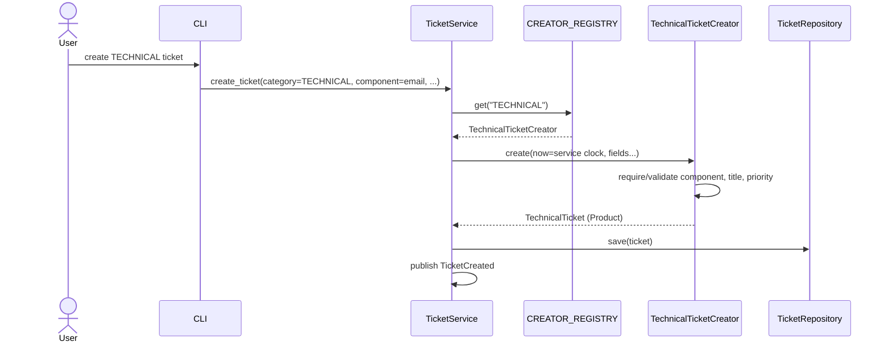

# Factory Method pattern - ticket categories

## Sequence: create through the factory

The clock is owned by the service (contract amendment #1); creators only
validate and build. Evidence: `tests/test_factory.py` (18+ tests).
