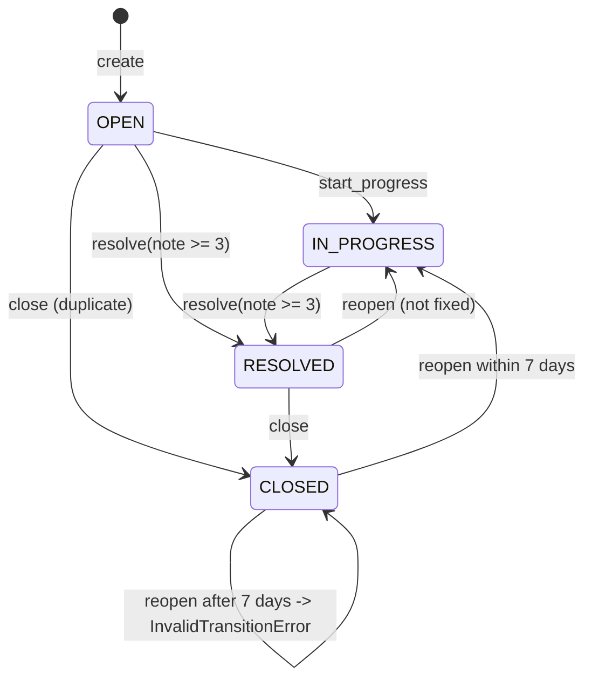
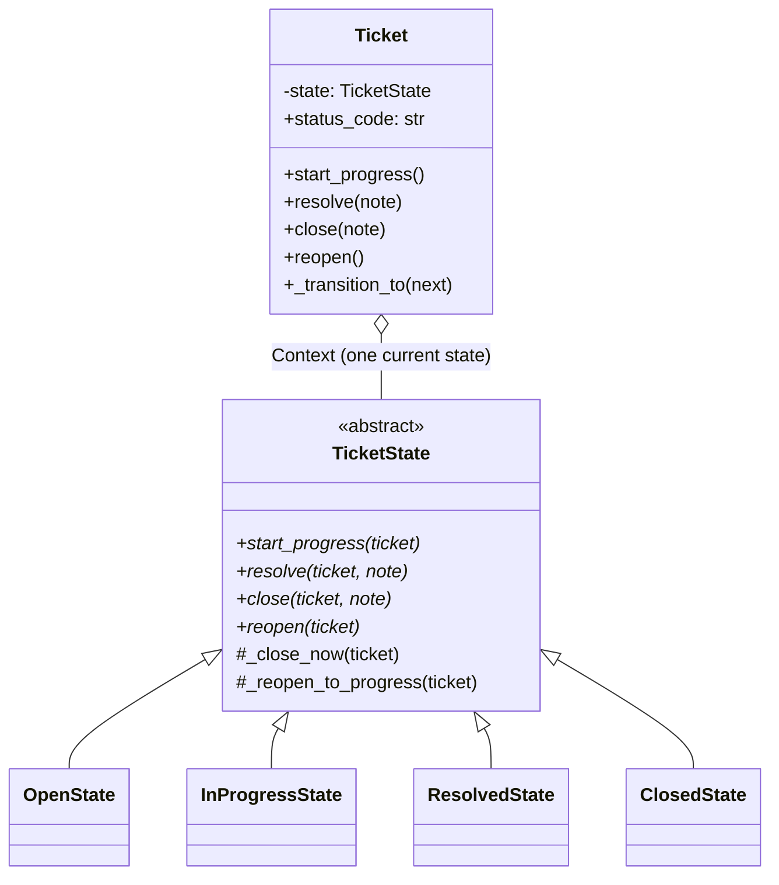

# State pattern - lifecycle state machine (BR-1 / BR-2)

## State diagram



Every arrow not drawn is an **explicit rejection** implemented in the source
state (never a silent no-op). `tests/test_state_matrix.py` pins all 16 cells.

## Class structure



## Reopen decision (BR-2)

```
reopen() on CLOSED:
    closed_at is None          -> InvalidTransitionError("without a timestamp")
    now - closed_at > 7 days   -> InvalidTransitionError("more than 7 days ago")
    otherwise                  -> closed_at = None; resolution_note = None;
                                  state = IN_PROGRESS
```

The boundary is inclusive; a millisecond of scheduling jitter is tolerated,
one second past the boundary is refused. Code:
`src/helpdesk/patterns/state/states.py`. Evidence: `tests/test_state.py`,
`tests/test_state_matrix.py`, `tests/test_reopen_window.py`.
