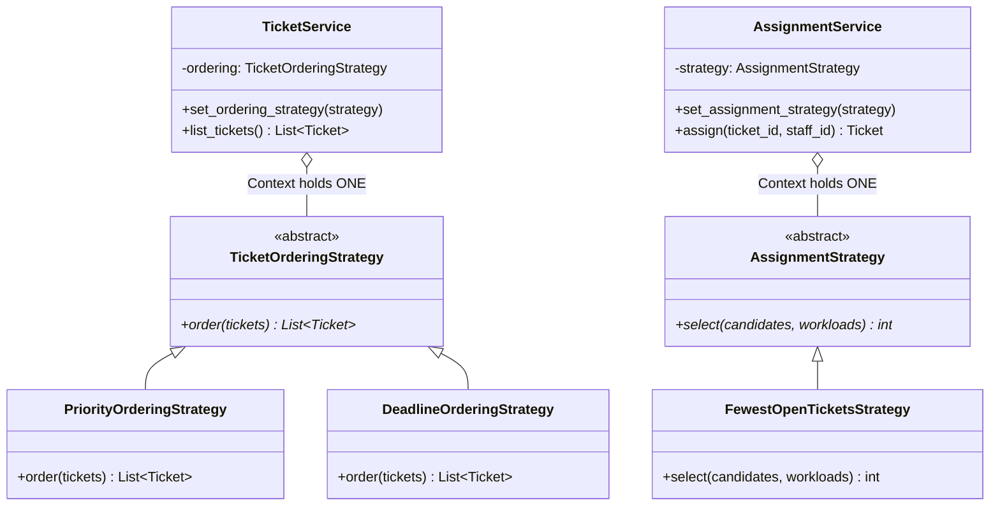
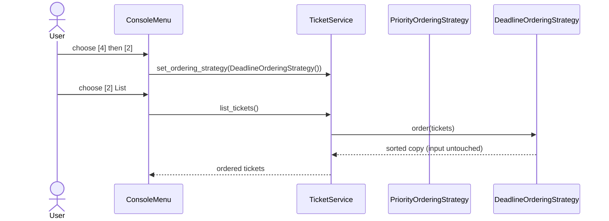

# Strategy pattern - ordering and assignment

Two independent Strategy families share the same shape: a Context holds one
policy object and calls it through an abstract interface.

## Sequence: switching ordering at runtime (FR-10)

**Contexts:** `TicketService` (ordering) and `AssignmentService` (assignment).
**Evidence:** `tests/test_strategy.py`, `tests/test_integration.py`.
