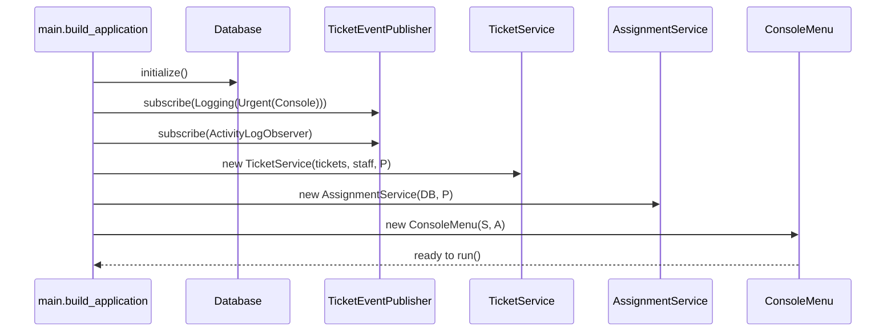
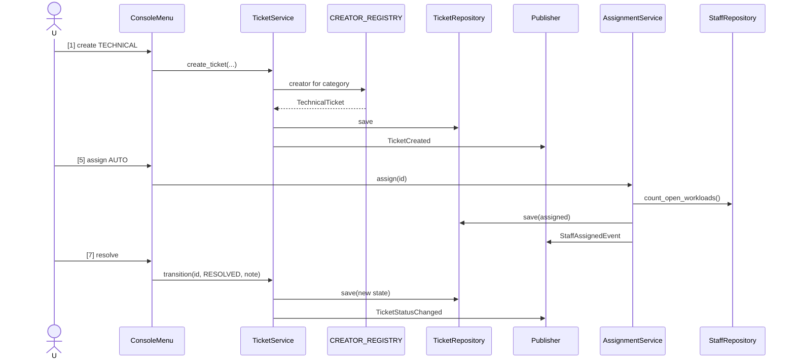

# Wiring diagram - full object graph

The composition root is the only place that names concrete classes and builds
the object graph (`src/helpdesk/main.py::build_application`).

```mermaid
flowchart TB
    CLI[ConsoleMenu] -->|use cases| TS[TicketService]
    CLI -->|use cases| AS[AssignmentService]
    TS -->|save/find| TR[TicketRepository]
    AS -->|save/get| TR
    AS -->|list/count| SR[StaffRepository]
    TS -->|publish| PUB[TicketEventPublisher]
    AS -->|publish| PUB
    PUB -->|notify| DEC[Logging(Urgent(Console))]
    PUB -->|notify| ALO[ActivityLogObserver]
    DEC --> CON[ConsoleNotificationObserver]
    ALO --> AR[ActivityRepository]
    TR --> DB[(Database / SQLite)]
    SR --> DB
    AR --> DB
    TS -.->|holds| ORD[Ordering Strategy]
    AS -.->|holds| ASS[Assignment Strategy]
    TS -.->|resolves category| REG[CREATOR_REGISTRY]
    REG -.-> CRE[Concrete Creators]
```

## Sequence: application startup



## Sequence: create -> assign -> resolve



Evidence: `tests/test_integration.py`, `tests/test_integration_suite.py`,
`tests/test_cli_parsing.py`.
